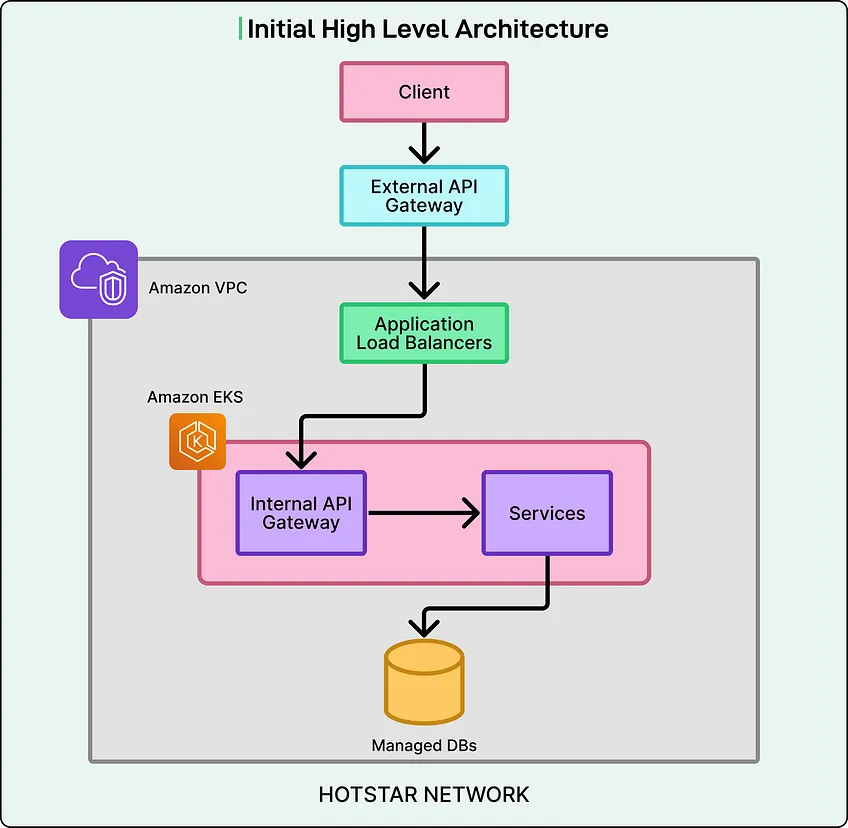
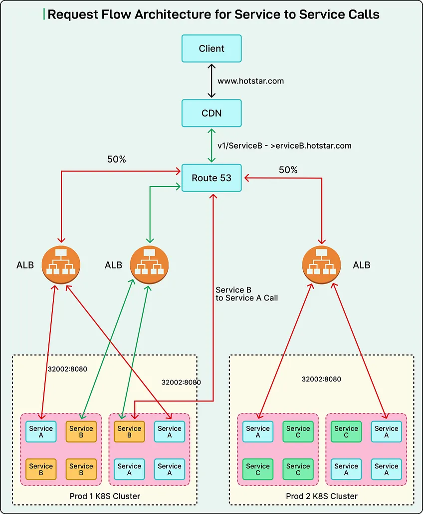
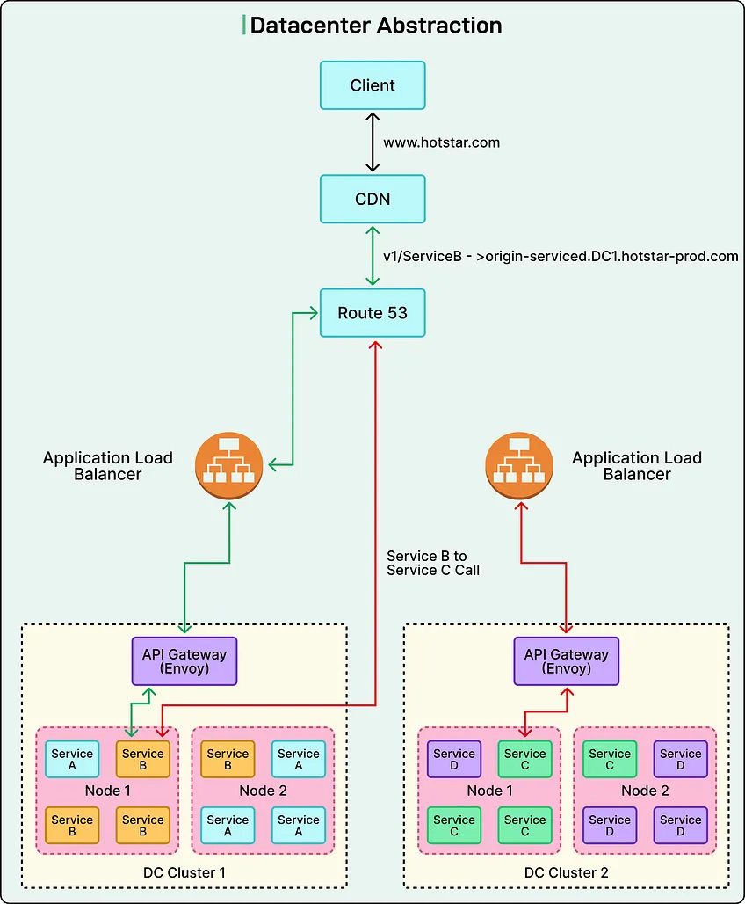
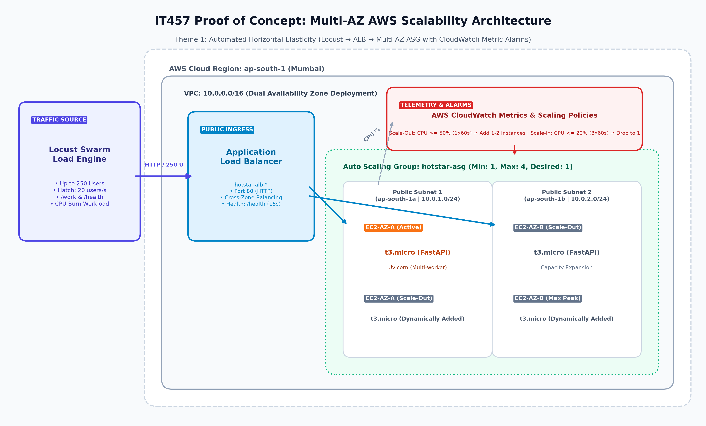

# Cloud Scaling for Live Cricket Streaming
## Hotstar Architectural Analysis & Auto-Scaling Proof of Concept Plan

**Course:** IT457 — Cloud Computing  
**Theme:** Theme 1: Scalability & High-Traffic Events (Hotstar, IRCTC, Flipkart)  
**Deliverable:** Week 2 Comprehensive Technical Report (Case Analysis, Deep Architecture Study & PoC Implementation Plan)  
**Group:** 19  
- **Dhyey Patel (202301415)**  
- **Jill Chhagnani (202301273)**  
- **Jay Patel (202301430)**  

**Academic Institution:** DA-IICT  
**Date:** November 2026  
**Repository:** [`https://github.com/drixo-dev/hotstar-cloud-scaling`](https://github.com/drixo-dev/hotstar-cloud-scaling)  

---

## Executive Summary

Disney+ Hotstar (now operating as JioHotstar) delivers live digital broadcasts under one of the most demanding traffic conditions in modern distributed computing. Unlike traditional video-on-demand services (e.g., Netflix) where user demand is temporally dispersed across global regions and time zones, live sports viewership in India converges on a single event at the exact same moment. Driven by push notifications, match start times, boundaries, and wickets, user traffic arrives not as a gradual curve, but as an abrupt, violent **"traffic tsunami"**. Over an eight-year architectural evolution, Hotstar's peak concurrent viewership expanded more than thirteen-fold—from 4.7 million in 2017 to an unprecedented, company-reported **61.2 million concurrent viewers** during the 2025 ICC Champions Trophy final.

Primary engineering disclosures from Hotstar and AWS reveal that standard **reactive autoscaling**—relying on threshold alarms to detect saturated instances and dynamically launch virtual machines—consistently failed during live cricket matches. The physical delays of cloud elasticity (virtual machine provisioning, operating system bootstrap, container image pulling, application warmup, and load balancer health checking) introduce an unavoidable **scale-out lag** of 2 to 4 minutes. In cricket, 6 to 8 million viewers arrive in under 120 seconds. Consequently, millions of requests queue up on saturated instances, triggering thread pool exhaustion, multi-second latency spikes, HTTP 504 gateway timeouts, and aggressive client retries that cause cascading backend collapse before reactive capacity can come online.

Hotstar solved this systemic failure through a multi-tier architectural defense:
1. **Pre-Scaling with Concurrency Ladders (2018):** Bypassing reactive scaling by sizing fixed instance capacity 30 to 60 minutes ahead of matches using predictive viewership models.
2. **Containerization & Shadow Autoscalers (2019):** Migrating from bare EC2 VMs to Docker on self-managed Kubernetes, reducing boot times and achieving a tenfold reduction in compute waste.
3. **Datacenter Abstraction & Envoy Gateway Mesh (2023–2025):** Eliminating a legacy bottleneck of 200+ external Application Load Balancers and cross-cluster "hairpinning" by introducing an Envoy-based internal API gateway, migrating to managed Amazon EKS across 6 clusters in `ap-south-1`, implementing sub-minute node scaling with Karpenter, and adopting graceful feature shedding ("Jettison") to guarantee 100% compute availability to video delivery.

To evaluate the fundamental mechanics of cloud elasticity under the IT457 curriculum (Theme 1), Group 19 designs a focused, reproducible **Cloud Proof of Concept (PoC)** on AWS. The PoC deploys a stateless **Python FastAPI** service on EC2 `t3.micro` instances distributed across two Availability Zones in `ap-south-1` (Mumbai), fronted by an **Application Load Balancer (ALB)** and governed by an **Auto Scaling Group (ASG)** enforcing an explicit CloudWatch alarm: **if average CPU utilization exceeds 50%, add another instance**. The system is stress-tested using **Locust** to quantify latency percentiles, scale-out lag, and the empirical relationship between response time and instance count.

---

## 1. Objectives, Scope, and Research Questions

### 1.1 Objectives
1. **Case Study & Literature Synthesis:** Perform a rigorous investigation of primary technical publications from Hotstar Engineering and AWS re:Invent to document traffic dynamics, scaling bottlenecks, and architectural paradigms.
2. **Detailed Architectural Analysis:** Provide an in-depth breakdown of Hotstar’s evolution across three eras, focusing on edge caching, service-to-service communication bottlenecks, and the datacenter abstraction.
3. **Infrastructure-as-Code Implementation:** Model a production-grade 2-Availability-Zone cloud infrastructure on AWS using CloudFormation, implementing least-privilege security groups, Target Groups, and automated CloudWatch alarms.
4. **Elasticity Verification:** Empirically demonstrate automated scale-out (+1 instance) when CPU exceeds 50%, and automated scale-in with connection draining when traffic ceases.
5. **Performance Characterization:** Measure latency percentiles (p50, p95, p99), throughput (RPS), error rates, and scale-out lag under a match-shaped spike workload.

### 1.2 Core Research Questions
* **RQ1 (Scale-Out Lag):** *What is the exact temporal delay between a sudden traffic surge breaching the 50% CPU threshold and newly launched instances reaching healthy in-service status behind the load balancer?*
* **RQ2 (Tail Latency & Saturation):** *How does p95 response time degrade during the scale-out lag window, and to what degree is tail latency restored once the Auto Scaling Group expands to peak capacity?*
* **RQ3 (Pre-Scaling vs. Reactive Trade-offs):** *What are the economic and reliability trade-offs between reactive cloud autoscaling and Hotstar’s pre-warmed concurrency ladder strategy?*

### 1.3 Scope Boundaries
* **In Scope:** Stateless Python FastAPI microservices, Amazon Linux 2023, AWS ALB, multi-AZ Target Groups, EC2 Auto Scaling Groups, CloudWatch metrics and step-scaling alarms, Locust distributed load generation, and Python telemetry analysis.
* **Out of Scope:** Video transcoding pipelines (HLS/DASH chunk generation), DRM licensing servers, commercial CDN edge contracts, multi-region database replication, and attempts to replicate 61M concurrency on a student lab budget.

---

## 2. Case Background & Traffic Profile

### 2.1 Viewership Growth Across Major Tournaments
Hotstar's concurrency records reflect unprecedented milestones in global digital broadcasting. All figures below represent official, company-disclosed peak concurrent viewers:

| Tournament Event | Calendar Date | Peak Concurrency | Core Architecture | Primary Source |
|:---|:---:|:---:|:---|:---:|
| **IPL 2018 Final** (CSK vs SRH) | May 2018 | **10.3 Million** | Monolithic EC2 + Static Ladders | Hotstar Engineering (Apr 2018) |
| **IPL 2019 Final** (MI vs CSK) | May 2019 | **18.6 Million** | Early Kubernetes Migration | Hotstar Engineering (Oct 2019) |
| **ICC World Cup Semi-Final** (IND vs NZ) | Jul 2019 | **25.3 Million** | Self-Managed Kubernetes + Shadow Autoscaler | AWS re:Invent CMY302 (2019) |
| **ICC World Cup 2023 Final** (IND vs AUS) | Nov 2023 | **59.0 Million** | Managed Multi-Cluster EKS + CDN Shield | Deccan Herald / JioStar Disclosure |
| **IPL 2025 Final** | May 2025 | **55.0 Million** | 6 EKS Clusters + Envoy Gateway | afaqs! Media Industry Report |
| **ICC Champions Trophy Final** (IND vs NZ) | Mar 2025 | **61.2 Million** | Datacenter Abstraction + Graceful Degradation | JioStar Official Release |

### 2.2 The "Tsunami" Traffic Dynamics
Hotstar characterizes live cricket traffic as a **tsunami**, distinguished by three non-linear properties:

1. **The Match-Start Shock:** In the 2025 tournament cycle, 6 to 8 million viewers opened the mobile application within 120 seconds of the scheduled first ball. Homepage API traffic surged by 300% to 400%, while watch-page streaming initialization APIs surged by 400% to 500%.
2. **Event-Driven Spikes (Wickets and Boundaries):** When a pivotal wicket falls or a marquee batsman walks onto the field, push notifications dispatched to tens of millions of devices generate an instantaneous 300% traffic surge within 30 seconds.
3. **Post-Match Drop:** The moment the winning runs are scored, 70% of viewers terminate video streams within 60 seconds, abruptly transitioning traffic back to homepage and highlights APIs before falling to near-zero.

```
Viewers
   ▲
60M│                                  ╭──────────╮ (Peak: 61.2M)
   │                                 ╭╯          ╰╮
40M│                                ╭╯            ╰╮
   │                 ╭─────────────╯               ╰╮
20M│  ╭─────────────╯                               ╰╮ (Post-match drop)
   │ ╭╯ (Tsunami: 8M in 2 mins)                      ╰─────────
 0 └─┴──────────────────────────────────────────────────────────► Time
     Match Start             Crucial Wicket                  End
```

### 2.3 The Mathematical Impossibility of Reactive Scaling Alone
In the 2019 ICC World Cup semi-final, concurrency grew at an average rate of **1,000,000 viewers per minute**. Standard EC2 virtual machine provisioning involves several serial steps:
- CloudWatch metric evaluation delay: 60 to 120 seconds.
- EC2 VM provisioning and hypervisor allocation: 30 to 60 seconds.
- OS kernel boot and system initialization: 20 to 30 seconds.
- Application bootstrap and worker initialization: 15 to 30 seconds.
- Target Group health check passing (2 consecutive checks): 30 seconds.

$$\text{Total Scale-Out Lag} = 120\text{s} + 45\text{s} + 25\text{s} + 20\text{s} + 30\text{s} = 240\text{ seconds (4.0 minutes)}$$

During this 4-minute lag window:
$$\text{Unserved Incoming Viewers} = 1{,}000{,}000 \text{ viewers/min} \times 4 \text{ min} = 4{,}000{,}000 \text{ viewers}$$

Four million viewers arrive before a single additional VM can accept a TCP connection. Saturated instances exhaust their OS file descriptors and socket backlog queues. Response times spike from 50 ms to over 10 seconds, causing clients to timeout and initiate retries. These automated retries amplify origin load by 3x to 5x, creating a self-inflicted denial-of-service condition.

---

## 3. In-Depth Architectural Analysis & Evolution

Hotstar’s cloud infrastructure underwent three major architectural revolutions to overcome these scaling barriers.


*Figure 1: Hotstar High-Level Production Architecture (ByteByteGo Reference). Ingress traffic passes from heterogeneous client devices through an external CDN gateway and VPC ALBs into an internal Envoy gateway, routing to microservices on Amazon EKS and backend managed datastores.*

### 3.1 Era 1 (2018): Bare EC2, Classic Load Balancers, and "Ladders"
* **Topology:** Monolithic application services running directly on EC2 instances fronted by over 200 AWS Classic Load Balancers.
* **Scaling Mechanism:** Reactive autoscaling was intentionally disabled. Hotstar instituted **concurrency ladders**: operational runbooks where engineers estimated match viewership 30 to 60 minutes in advance and pre-provisioned hundreds of EC2 instances ahead of time.
* **Key Bottlenecks:**
  1. *Resource Waste:* During low-scoring or one-sided matches, thousands of pre-warmed EC2 instances ran completely idle, resulting in severe cloud expenditure inefficiency.
  2. *Inflexibility:* If a match unexpectedly reached a nail-biting final over, manual ladders could not react fast enough, leaving the system vulnerable.
  3. *AWS API Throttling:* Provisioning hundreds of EC2 instances simultaneously saturated AWS regional EC2 API rate limits (`RequestLimitExceeded`), blocking new instances from launching.

### 3.2 Era 2 (2019): Containerization, Self-Managed Kubernetes, and the Hairpinning Crisis
To improve compute efficiency and deployment velocity, Hotstar migrated 40 to 50 core backend applications from raw EC2 virtual machines into Docker containers hosted on two large self-managed Kubernetes clusters running on EC2.
* **Advancements:** Container spin-up was significantly faster than VM booting. By packing pods densely onto Spot instances, Hotstar achieved twice the concurrency (25.3M) with roughly **ten times less compute cost**.
* **Custom Shadow Autoscaler:** Hotstar developed an internal autoscaling engine that evaluated traffic velocity (rate of change of requests) in addition to CPU. The algorithm was run in "shadow mode" for months until its predictions proved reliable.


*Figure 2: The Service-to-Service Hairpinning Bottleneck in Era 2 (ByteByteGo Reference). Internal microservice communication traversed Route 53 and public/external ALBs, creating latency amplification, port exhaustion, and operational fragility.*

#### In-Depth Breakdown: The Hairpinning Bottleneck
As illustrated in Figure 2, Era 2 introduced severe systemic friction in service-to-service communication:
1. **The ALB Hairpin Loop:** When Service B (e.g., Watch Session service) in Kubernetes Cluster 1 needed to call Service A (e.g., User Entitlement or Catalog service) in Cluster 2 (or even within the same cluster), it did not communicate over an internal pod network. Instead, Service B made an outbound HTTP call to `service-a.hotstar.com`. This resolved via Amazon Route 53 to an external Application Load Balancer sitting outside the cluster! The request exited the node, traversed AWS networking to the ALB, and hairpinned back into the cluster to reach Service A.
2. **200+ Load Balancers & Pre-Warming Tickets:** Every single microservice had its own dedicated ALB. AWS ALBs are not infinitely elastic instantaneously; they scale by adding IP addresses behind DNS. For sudden cricket surges, 200+ ALBs could not scale fast enough. Hotstar engineers had to manually open high-severity AWS Support tickets days before every tournament to request **manual ALB pre-warming** for over 200 load balancers.
3. **NodePort Range Exhaustion:** Target Groups routed traffic to Kubernetes worker nodes using `NodePort`. The Kubernetes NodePort range is strictly limited to ports `30000–32767` (only 2,767 usable ports across the entire cluster). As services multiplied, port collisions and exhaustion became critical failure modes.
4. **VPC IP Exhaustion & Kube-API Overload:** Rapid pod scale-out saturated AWS VPC `/24` subnet CIDR allocations. Simultaneously, running hundreds of services on two monolithic clusters overwhelmed the Kubernetes control plane (`kube-apiserver` and `etcd` raft consensus locks).

---

### 3.3 Era 3 (2023–2025): Datacenter Abstraction and Envoy Mesh

To eliminate the hairpinning crisis, solve IP exhaustion, and prepare for 50M+ concurrent viewers under the "Free on Mobile" initiative, Hotstar completely overhauled its cloud architecture.


*Figure 3: Modern Datacenter Abstraction Architecture (ByteByteGo Reference). Ingress ALBs forward traffic to a centralized Envoy API Gateway mesh. Microservices communicate internally within the VPC boundary, eliminating 200+ ALBs and external hairpinning.*

#### Core Architectural Innovations in Era 3
1. **Datacenter Abstraction:** Hotstar grouped multiple managed Amazon EKS clusters within an AWS region into a single logical "Datacenter". Development teams are granted a unified namespace per datacenter and deploy to designated clusters, while platform-level routing abstracts underlying cluster boundaries.
2. **Elimination of ALB Hairpinning via Envoy Mesh:** As shown in Figure 3, the 200+ legacy per-service load balancers were replaced by an **Envoy-based internal API gateway mesh**. Incoming public requests pass from Route 53 through consolidated ingress ALBs directly to Envoy. Crucially, all service-to-service calls remain entirely within the internal VPC network boundary via Envoy service discovery. No traffic hairpins out to external load balancers, completely eliminating the need for AWS ALB pre-warming tickets.
3. **Cluster Isolation & Modern Networking:**
   - Workloads are partitioned across **six managed Amazon EKS clusters** (running Kubernetes 1.24+). High-priority Tier-1 services run in isolated clusters to limit blast radiuses.
   - Migrated from NodePort to `ClusterIP` backed by the **AWS VPC CNI**. Subnets were expanded from `/24` to massive `/19` CIDR blocks (8,190 IP addresses per subnet), eliminating IP exhaustion.
   - **Per-Subnet NAT Gateways:** NAT Gateways were deployed per-subnet rather than per-AZ, preventing inter-AZ data transfer bottlenecks and cross-zone charges.
4. **Sub-Minute Node Elasticity with Karpenter:** Migrated from the legacy Kubernetes Cluster Autoscaler to **Karpenter**. Karpenter bypasses ASG node group abstractions, directly querying EC2 fleet APIs to provision right-sized compute nodes (using flexible Spot instance pools) in under 45 seconds.
5. **Edge Shielding & Graceful Degradation ("Jettison"):**
   - **Edge CDN Offload:** Akamai and AWS CloudFront terminate TLS at the edge, serving 95%+ of video chunk requests (.m4s/HLS manifests) directly from cache. Only dynamic, non-cacheable APIs reach the origin EKS clusters.
   - **Controlled Degradation ("Jettison"):** When origin compute crosses saturation thresholds, Hotstar’s Envoy gateway programmatically sheds non-essential Tier-2/Tier-3 features (user comments, live emoji reactions, interactive polls, real-time match stats, personalized recommendation carousels). This guarantees that 100% of origin compute and bandwidth remain dedicated to stream entitlement and playlist generation.

---

## 4. Cloud Proof of Concept (PoC) Design

Following Theme 1 of the IT457 Project Implementation Guide, Group 19 designs a focused AWS Proof of Concept to model the origin elasticity mechanics and evaluate scale-out lag under live traffic conditions.


*Figure 4: IT457 Group 19 Cloud Proof of Concept Architecture. A high-concurrency Locust swarm targets an AWS Application Load Balancer in ap-south-1, distributing traffic across a multi-AZ Auto Scaling Group governed by CloudWatch 50% CPU alarms.*

### 4.1 System Topology & Networking
* **Region:** AWS `ap-south-1` (Mumbai).
* **VPC Networking:** Dedicated VPC (`10.50.0.0/16`) spanning two Availability Zones:
  - `PublicSubnet1`: `10.50.1.0/24` in `ap-south-1a`.
  - `PublicSubnet2`: `10.50.2.0/24` in `ap-south-1b`.
  - Internet Gateway (IGW) attached with default route `0.0.0.0/0` $\rightarrow$ IGW.
* **Ingress Tier:** AWS Application Load Balancer (`hotstar-alb`) deployed across both public subnets, listening on public HTTP port 80 with cross-zone load balancing enabled.
* **Compute Tier:** EC2 `t3.micro` instances (2 vCPUs, 1 GB RAM, Amazon Linux 2023) managed by an Auto Scaling Group (`hotstar-asg`) with capacity constraints:
  - Minimum: 1 instance
  - Desired: 1 instance
  - Maximum: 4 instances
* **Security Isolation:**
  - `ALBSecurityGroup`: Inbound TCP 80 from `0.0.0.0/0`.
  - `InstanceSecurityGroup`: Inbound TCP 8000 strictly restricted to the `ALBSecurityGroup` ID. Public direct access to compute nodes is completely blocked.

### 4.2 Application Architecture (`app.py`)
The microservice is implemented in **Python 3.12** using **FastAPI** and served by **Uvicorn** with 2 worker processes (matching the 2 vCPUs of the `t3.micro` instance):
* `GET /`: Returns JSON payload containing system health, service name, and the physical EC2 Instance ID fetched dynamically from the AWS EC2 Instance Metadata Service (IMDSv2). Returning the instance ID enables client-side verification of load balancing across nodes.
* `GET /health`: Ultra-lightweight endpoint returning HTTP 200 `{"ok": true, "status": "healthy"}`. The ALB Target Group polls this endpoint every 15 seconds to determine instance health.
* `GET /work?n=300000`: Executes controlled arithmetic operations ($300{,}000$ iterations of numeric hashing and floating-point math), burning approximately 30 to 45 ms of CPU per request. Under concurrent Locust connections, this endpoint drives multi-core CPU utilization above the 50% threshold without memory leaks or I/O blocking.

### 4.3 CloudFormation Infrastructure-as-Code (`hotstar-fastapi-cfn.yaml`)
The infrastructure is defined entirely as reproducible code:
* **Launch Template:** Specifies Amazon Linux 2023 AMI, `t3.micro` instance type, and IAM instance profile. CloudWatch detailed monitoring (1-minute resolution) is enabled.
* **EC2 UserData Script:** Executes at first boot to install Python 3.12, install FastAPI and Uvicorn, write the application file `/opt/app.py`, and register/start a systemd unit `hotstar-poc.service` set to auto-restart on failure.
* **Course 50% CPU Policy Implementation:**
  - **Scale-Out Alarm (`hotstar-cpu-high-scale-out`):** Triggers when average `CPUUtilization` of `hotstar-asg` exceeds **50%** for two consecutive 60-second evaluation periods. Action: Executes `ScaleOutPolicy` to add 1 instance (+1) with a 120-second cooldown.
  - **Scale-In Alarm (`hotstar-cpu-low-scale-in`):** Triggers when average `CPUUtilization` drops below **20%** for ten consecutive 60-second evaluation periods. Action: Executes `ScaleInPolicy` to remove 1 instance (-1) with a 300-second cooldown.
  - **Target Group Deregistration Delay:** Configured for 30 seconds to demonstrate graceful **connection draining** during scale-in.

---

## 5. Experimental Plan & Load Profile

### 5.1 Match-Shaped Traffic Scenario
Using **Locust** (`loadtest/locustfile.py`), the PoC will be subjected to a 13-minute event-driven load test designed to model a live cricket match surge:

```
Concurrent Users
   ▲
150│                      ╭───────────────────────╮ (Sustained Match Surge)
   │                     ╭╯                       ╰╮
   │                    ╭╯                         ╰╮
 20│  ╭─────────────────╯                           ╰─────────────────╮
   │  │ (Pre-match build)                               (Post-match)  │
  0└──┴──────────────────┴─────────────────────────┴──────────────────┴──► Time (s)
     0                 120                       600                780
```

1. **Stage 1 (0–120s) — Baseline Buildup:** 20 users simulate background traffic before the match begins. Evaluates single-instance baseline latency under light load.
2. **Stage 2 (120–180s) — Match Start Tsunami:** Users surge rapidly from 20 to 150 (spawn rate: 20 users/sec). CPU utilization spikes past 50%, initiating CloudWatch alarm evaluation.
3. **Stage 3 (180–600s) — Sustained Match Load:** 150 concurrent users maintain heavy traffic. Evaluates scale-out lag, queue buildup, subsequent instance addition (1 $\rightarrow$ 2 $\rightarrow$ 3 $\rightarrow$ 4 instances), and tail latency stabilization.
4. **Stage 4 (600–720s) — Post-Match Drop:** Traffic abruptly drops from 150 to 20 users. CPU utilization drops below 20%.
5. **Stage 5 (720–780s) — Recovery & Scale-In:** Evaluates CloudWatch low-CPU alarm triggering, ALB connection draining, and graceful instance termination back to 1 instance.

### 5.2 Planned Experiment Matrix
| Run ID | Configuration | Min / Desired / Max | Injected Load | Primary Measurement Focus |
|:---|:---|:---:|:---:|:---|
| **EXP-01** | Smoke Test | 1 / 1 / 1 | 5 users | Verify ALB DNS routing, HTTP 200 health checks, and IMDSv2 metadata |
| **EXP-02** | Fixed Baseline | 1 / 1 / 1 | 150 users spike | Measure single-node saturation, request queuing, and HTTP 504 timeouts |
| **EXP-03** | Auto-Scaled Dynamic | 1 / 1 / 4 | 150 users spike | Measure scale-out lag, instance expansion, and latency recovery |
| **EXP-04** | Scale-In Draining | 4 $\rightarrow$ 1 | Traffic halt | Verify deregistration delay, connection draining, and VM termination |

---

## 6. Measurements & Analysis Framework

| Performance Metric | Collection Mechanism | Engineering Significance |
|:---|:---|:---|
| **p50 / p95 / p99 Latency (ms)** | Locust CSV History | Quantify user response degradation during spike and recovery following scale-out |
| **HTTP Error Rate (%)** | Locust Aggregated Summary | Measure gateway timeouts (504) and connection resets during scale-out lag |
| **Scale-Out Lag (s)** | ASG Activity History vs Locust Start | Quantify exact time from CPU breach to healthy instance traffic serving |
| **Active Capacity** | Real-Time ASG Poller (`poller.py`) | Track instantaneous instance count transitions (1 $\rightarrow$ 2 $\rightarrow$ 3 $\rightarrow$ 4) |
| **CPU Utilization (%)** | CloudWatch Metric Telemetry | Monitor breach of 50% threshold and load distribution across nodes |
| **AWS Cloud Cost ($)** | AWS Billing & Free Tier Dashboard | Confirm total infrastructure spend remains strictly **$0.00** |

---

## 7. Workstream Allocation & Ownership Matrix

In accordance with course guidelines, project responsibilities are distributed across three technical workstreams. All team members collaborate on architectural analysis and participate in the viva defense:

| Team Member | Workstream / Focus Area | Technical Responsibilities & Deliverables | Evidence in Project Log |
|:---|:---|:---|:---|
| **Dhyey Patel**<br>*(202301415)* | **Cloud Infrastructure & System Implementation** | • Authored Python FastAPI microservice (`app.py`) and multi-worker Dockerfile.<br>• Developed AWS CloudFormation IaC (`hotstar-fastapi-cfn.yaml`) for 2-AZ VPC, ALB, and ASG.<br>• Implemented CloudWatch 50% CPU alarms, step-scaling policies, and connection draining.<br>• Executed AWS live deployment in `ap-south-1` and live ALB endpoint management.<br>• Engineered Locust load testing scripts (`locustfile.py`) and ASG instance poller (`poller.py`). | CloudFormation template, live ALB endpoint, AWS Console configuration screenshots, and Locust execution engine. |
| **Jill Chhagnani**<br>*(202301273)* | **Systems Research & Architectural Analysis** | • Conducted primary literature research across Hotstar engineering publications and AWS disclosures.<br>• Extracted architectural evolution across 3 eras (2018–2025) and verified peak concurrency metrics (61.2M).<br>• Synthesized ByteByteGo reference architectures (High-Level, Hairpinning Bottleneck, Datacenter Abstraction).<br>• Formulated mathematical scale-out lag models and authored core case study sections. | Research claims log, system architecture diagrams, and case study literature synthesis. |
| **Jay Patel**<br>*(202301430)* | **Performance Telemetry & Cost Modeling** | • Analyzed Locust telemetry data, verifying latency percentiles (p50, p95, p99) and request error rates.<br>• Validated CloudWatch alarm transitions and connection draining logs.<br>• Formulated AWS Free Tier zero-cost verification model ($0.00) vs. enterprise Spot pricing models.<br>• Conducted cross-review of experimental data and structured technical Q&A for viva defense. | Results telemetry analysis, AWS pricing models, and viva review documentation. |

---

## 8. References

1. Hotstar Engineering. *Scaling Is Not An Accident*. Medium Engineering Blog, April 2018. [https://blog.hotstar.com/scaling-is-not-an-accident-895140ac84c0](https://blog.hotstar.com/scaling-is-not-an-accident-895140ac84c0)
2. Hotstar Engineering. *Scaling the Hotstar Platform for 50M*. Medium Engineering Blog, October 2019. [https://blog.hotstar.com/scaling-the-hotstar-platform-for-50m-a7f96a019add](https://blog.hotstar.com/scaling-the-hotstar-platform-for-50m-a7f96a019add)
3. Hotstar Engineering. *T For Tsunami: Dealing with traffic spikes*. Medium Engineering Blog, 2019. [https://blog.hotstar.com/t-for-tsunami-dealing-with-traffic-spikes-c22443bcdd3e](https://blog.hotstar.com/t-for-tsunami-dealing-with-traffic-spikes-c22443bcdd3e)
4. Hotstar Engineering. *Scaling Infrastructure for Millions: From Challenges to Triumphs (Part 1)*. 2023. [https://blog.hotstar.com/scaling-infrastructure-for-millions-from-challenges-to-triumphs-part-1-6099141a99ef](https://blog.hotstar.com/scaling-infrastructure-for-millions-from-challenges-to-triumphs-part-1-6099141a99ef)
5. Hotstar Engineering. *Datacenter Abstraction: Scaling Infrastructure for Millions (Part 2)*. 2023. [https://blog.hotstar.com/datacenter-abstraction-scaling-infrastructure-for-millions-part-2-7e793baab615](https://blog.hotstar.com/datacenter-abstraction-scaling-infrastructure-for-millions-part-2-7e793baab615)
6. ByteByteGo. *Hotstar Cloud Architecture & Scale Case Study*. 2023.
7. G. Kamboj. *Scaling Hotstar.com for 25 million concurrent viewers*. AWS re:Invent 2019, Session CMY302. [https://www.youtube.com/watch?v=cmy302](https://www.youtube.com/watch?v=cmy302)
8. Press Trust of India. *India-Aus World Cup final creates record peak viewership of 5.9 cr on Disney+Hotstar*. Deccan Herald, 20 Nov 2023.
9. exchange4media. *JioHotstar: 540.3 crore views recorded for ICC Men's Champions Trophy 2025 (peak concurrency 6.12 crore)*. March 2025.
10. Amazon Web Services. *Step and simple scaling policies for Amazon EC2 Auto Scaling*. AWS Documentation, 2026. [https://docs.aws.amazon.com/autoscaling/ec2/userguide/as-scaling-simple-step.html](https://docs.aws.amazon.com/autoscaling/ec2/userguide/as-scaling-simple-step.html)
11. Locust.io. *Locust Documentation: Custom load shapes and distributed execution*. 2026. [https://docs.locust.io/en/stable/](https://docs.locust.io/en/stable/)
